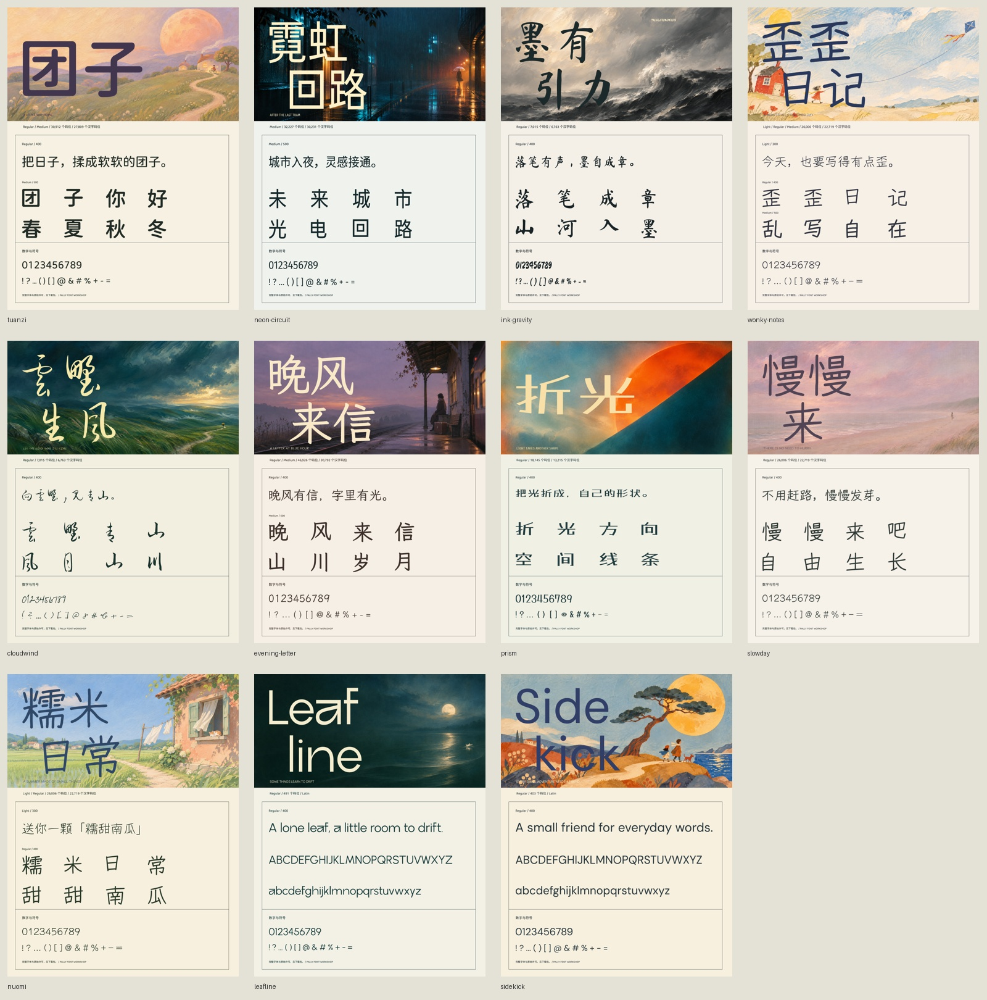

# Pally Font Workshop · 字体小工坊

简体、繁体、英文的字体制作 Skills，以及一组可以免费下载的字体与故事海报。

[全部字体下载](https://github.com/4chuanMcChicken/pally-font-workshop/releases/download/v1.0.1/Pally-All-Fonts-v1.0.1.zip) · [全部 Skills 下载](https://github.com/4chuanMcChicken/pally-font-workshop/releases/download/v1.0.1/Pally-Font-Skills-v1.0.1.zip) · [海报下载](https://github.com/4chuanMcChicken/pally-font-workshop/releases/download/v1.0.1/Pally-Posters-v1.0.1.zip) · [English](docs/README.en.md)



## 先下载，再慢慢挑

11 个字体家族，16 个真实字体文件。解压每套字体包，第一层就是安装文件，其余内容收在 `资料/`。

| 这次的名字 | 原来的项目名 | 真实字重 | 字符范围 | 下载与预览 |
|---|---|---|---|---|
| 团子 | 小伴 | Regular / Medium | 27,809 汉字映射 | [下载字体包](https://github.com/4chuanMcChicken/pally-font-workshop/releases/download/v1.0.1/Pally-tuanzi-v1.0.1.zip) · [看海报](posters/01-tuanzi.png) |
| 霓虹回路 | Circuit | Medium | 30,231 汉字映射 | [下载字体包](https://github.com/4chuanMcChicken/pally-font-workshop/releases/download/v1.0.1/Pally-neon-circuit-v1.0.1.zip) · [看海报](posters/02-neon-circuit.png) |
| 墨有引力 | Ink | Regular | 6,763 汉字映射 | [下载字体包](https://github.com/4chuanMcChicken/pally-font-workshop/releases/download/v1.0.1/Pally-ink-gravity-v1.0.1.zip) · [看海报](posters/03-ink-gravity.png) |
| 歪歪日记 | 乱写 | Light / Regular / Medium | 22,719 汉字映射 | [下载字体包](https://github.com/4chuanMcChicken/pally-font-workshop/releases/download/v1.0.1/Pally-wonky-notes-v1.0.1.zip) · [看海报](posters/04-wonky-notes.png) |
| 云野生风 | 云野 | Regular | 6,763 汉字映射 | [下载字体包](https://github.com/4chuanMcChicken/pally-font-workshop/releases/download/v1.0.1/Pally-cloudwind-v1.0.1.zip) · [看海报](posters/05-cloudwind.png) |
| 晚风来信 | 叶舟 | Regular / Medium | 30,792 汉字映射 | [下载字体包](https://github.com/4chuanMcChicken/pally-font-workshop/releases/download/v1.0.1/Pally-evening-letter-v1.0.1.zip) · [看海报](posters/06-evening-letter.png) |
| 折光 | 葉光 | Regular | 13,215 汉字映射 | [下载字体包](https://github.com/4chuanMcChicken/pally-font-workshop/releases/download/v1.0.1/Pally-prism-v1.0.1.zip) · [看海报](posters/07-prism.png) |
| 慢慢来 | 自在 | Regular | 22,719 汉字映射 | [下载字体包](https://github.com/4chuanMcChicken/pally-font-workshop/releases/download/v1.0.1/Pally-slowday-v1.0.1.zip) · [看海报](posters/08-slowday.png) |
| 糯米日常 | 糯甜 | Light / Regular | 22,719 汉字映射 | [下载字体包](https://github.com/4chuanMcChicken/pally-font-workshop/releases/download/v1.0.1/Pally-nuomi-v1.0.1.zip) · [看海报](posters/09-nuomi.png) |
| Leafline | Leafline | Regular | 491 码位 | [下载字体包](https://github.com/4chuanMcChicken/pally-font-workshop/releases/download/v1.0.1/Pally-leafline-v1.0.1.zip) · [看海报](posters/10-leafline.png) |
| Sidekick | Pally | Regular | 403 码位 | [下载字体包](https://github.com/4chuanMcChicken/pally-font-workshop/releases/download/v1.0.1/Pally-sidekick-v1.0.1.zip) · [看海报](posters/11-sidekick.png) |

「霓虹回路」保留原生 OTF 格式，其余为 TTF。没有把 OTF 改后缀伪装成 TTF，也没有合成不存在的粗体。

名字是本次策展与衍生版本的名字，**不代表全部轮廓由我们原创绘制**。底库选型、少数字形定制和整套几何变换在 [来源与致谢](ACKNOWLEDGEMENTS.md) 及各字体 `资料/SOURCE.json` 中分别写清。码位数不等于逐字视觉验收，也不等于地区字形标准认证。

## 做自己的字体

四个入口一起提供：

- `make-chinese-font`：中文总入口，整理需求、参考和简繁范围。
- `make-simplified-chinese-font`：简体入口，共用中文核心。
- `make-traditional-chinese-font`：繁体入口，共用中文核心。
- `make-english-font`：英文/Latin 参考、原生实例、测量和交付流程。

在可以读取 Agent Skills 的代理中使用。以 Codex 本地 Skill 目录为例：

```sh
git clone https://github.com/4chuanMcChicken/pally-font-workshop.git
cd pally-font-workshop
python3 scripts/install_skills.py --dry-run
python3 scripts/install_skills.py
```

安装器会在任何写入前检查全部目标，已有同名 Skill 时退出；不覆盖已有版本。可用 `--dest` 指定其他 Skill 目录。简体、繁体两个入口依赖同目录的 `make-chinese-font`，所以建议一起安装。

然后可以说：

> 参考这张图做一套简体中文字体，用于正文。先给我真实字体小样确认，再扩成完整包。

或：

> 用 make-english-font 做一套英文，保留参考里平顶 a 和宽肩 n 的特征，先看新旧字样对照。

## 它能做什么

从用途、简繁范围、字重、必需文字和参考开始；用真实 TTF/OTF 确认方向；基于允许修改的开放底库制作，核对覆盖、轮廓、排版与网页字体；输出可安装字体、许可和可试字手册。

它不是“一张图自动恢复所有原字体字形”的模型。原生轴只在底库的设计空间内工作，少数字形编辑也不自动推导全部汉字。英文可选拟合器与中文采用不同指标。具体边界在各 Skill 的 SKILL.md。

## 致谢

特别感谢 **[Arlan Marat（@arla6ka）](https://github.com/arla6ka)** 的 [design.how / make-font](https://github.com/arla6ka/design.how)。我们参考了其工作流，并在英文入口保留部分 MIT 脚本与原始版权；新增了中文、简繁路由、覆盖检查、小样反馈与更容易下载的交付。完整说明见 [ACKNOWLEDGEMENTS.md](ACKNOWLEDGEMENTS.md)。

也感谢 975 圆、Glow Sans、Ma Shan Zheng、Yozai、Liu Jian Mao Cao、LXGW WenKai、LXGW Marker Gothic、Urbanist、DM Sans 的作者与维护者。

## 许可

- Skills 与新增脚本：MIT；保留 Arlan Marat 等原作者版权。
- 字体软件：每套均保留 SIL OFL 1.1 及来源，不改成 MIT。
- 原创 AI 背景与海报图像：在我们可以授予的权利范围内按 CC0 1.0 共享；排版脚本为 MIT。
- 第三方参考截图不随包分发。「折光」「慢慢来」公开版从开放底库重建，不含私人研究版中来源未明确的截图字形。

字体可按 OFL 用于设计与商业项目；再分发或修改字体时请遵守各套原始许可与 Reserved Font Names，不能单独出售字体软件。[OFL 官方说明](https://openfontlicense.org/ofl-faq/)。

## 检查与重建海报 PDF

```sh
python3 -m venv .venv
. .venv/bin/activate
python -m pip install -r requirements.txt
python scripts/validate_release.py
python scripts/make_posters.py
```

海报名字、字样和符号均用实际字体的 HarfBuzz 排版及矢量轮廓绘制，背景没有 AI 生成文字。背景提示词完整保存在 `artwork/prompts.json`。整套 PDF 见 [poster-catalog.pdf](posters/poster-catalog.pdf)。

FontBakery、OTS、全部 IVS/竖排、所有语言与逐字审美质量未声明通过。已执行的发布检查记录在 [docs/release-validation.json](docs/release-validation.json)。

将 PDF 转为 2340×3060 PNG 可使用 Poppler：`pdftoppm -r 144 -png posters/poster-catalog.pdf page`。
汉字数量与中文 Skill 保持同一口径：统计统一汉字和兼容汉字码位，不将带框汉字、部首与笔画计作独立汉字。
